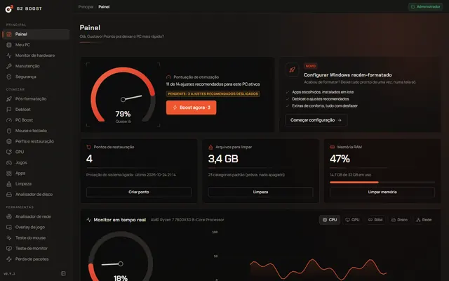
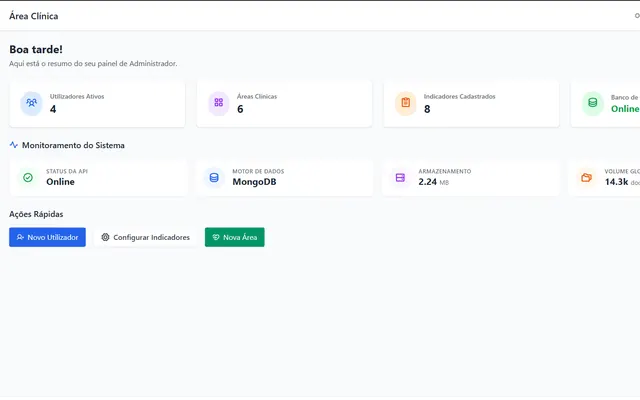
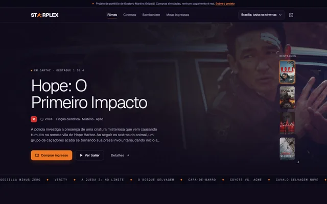
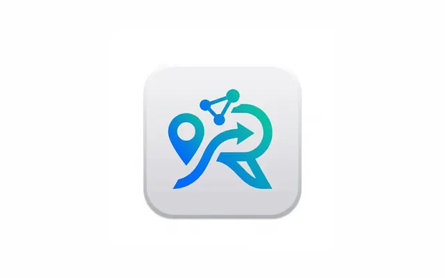
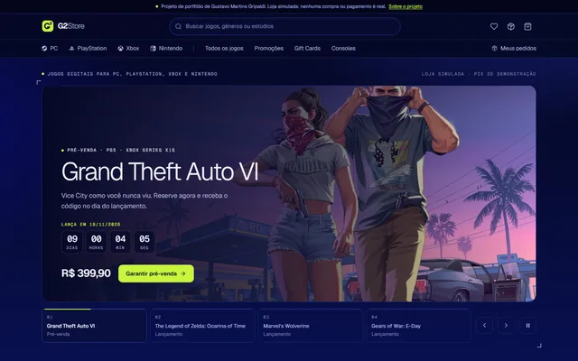
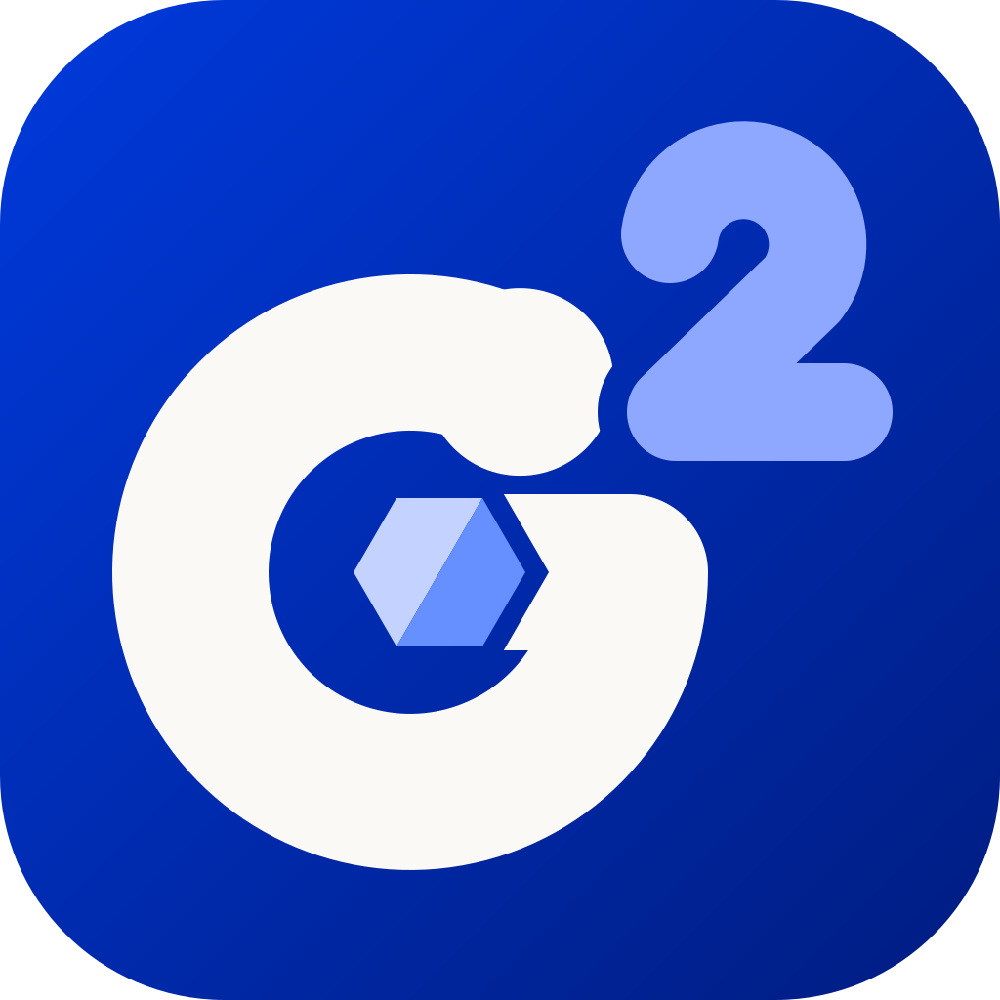

<a href="https://g2portfolio.grovicdata.com">
  <picture>
    <source media="(prefers-color-scheme: dark)" srcset="https://raw.githubusercontent.com/G2Martins/G2Martins/main/assets/header-dark.svg">
    
  </picture>
</a>

Data Engineer &amp; Full Stack Developer from Brasília, Brazil. Open to data engineering, BI and full stack roles, on-site or remote.

  
  
  
  

Sou Gustavo Martins Gripaldi, engenheiro de dados e desenvolvedor full stack em Brasília. Hoje sou **Assistente de Engenharia de Dados na Brasal Participações**, onde trabalho com Snowflake, SQL, PySpark, Microsoft Fabric e Power BI e levei cargas ETL do ERP SAP de **4 horas para 1 hora**. Antes dos dados, construí software: na PGFN entreguei em 8 meses uma plataforma de repositório digital que gerou **R$ 1 milhão de economia**. Também cofundei a [Grovic Data](https://grovicdata.com) e criei o [G2 Boost](https://github.com/G2Martins/G2-Boost/releases).

## Agora

| | Papel | Foco |
|:--|:--|:--|
| **Brasal Participações** | Assistente de Engenharia de Dados | Snowflake · SQL · PySpark · Power BI |
| **[Grovic Data](https://grovicdata.com)** | Cofundador | [Valerium](https://valerium.grovicdata.com) · [ProntuSMART](https://prontusmart.grovicdata.com) |
| **[G2 Boost](https://github.com/G2Martins/G2-Boost/releases)** | Criador · release v0.9.3 | Windows · Rust + React |

## Projetos em destaque

<table>
<tr>
<td width="33%" valign="top">
 
<b><a href="https://github.com/G2Martins/G2-Boost/releases">G2 Boost</a></b> Otimizador de desempenho para jogos no Windows: diagnóstico, debloat, rede e 62 ajustes reversíveis num só app. 
<code>Rust</code> <code>Tauri&nbsp;2</code> <code>React&nbsp;19</code> · <a href="https://github.com/G2Martins/G2-Boost/releases">Download v0.9.3</a>
</td>
<td width="33%" valign="top">
 
<b><a href="https://valerium.grovicdata.com">Valerium</a></b> Plataforma white-label multi-tenant de gestão empresarial: finanças, CRM, agendamento, contratos e IA. 
<code>Next.js</code> <code>tRPC</code> <code>Supabase</code> · <a href="https://valerium.grovicdata.com">Site</a>
</td>
<td width="33%" valign="top">
 
<b><a href="https://prontusmart.grovicdata.com">ProntuSMART</a></b> Prontuário eletrônico em produção para a Clínica Escola de Fisioterapia da UCB, com metas SMART e RBAC. 
<code>Angular</code> <code>FastAPI</code> <code>MongoDB</code> · <a href="https://prontusmart.grovicdata.com">Site</a> · <a href="https://github.com/G2Martins/ProntuSmart">Código</a>
</td>
</tr>
<tr>
<td width="33%" valign="top">
 
<b><a href="https://g2martins.github.io/Starplex/">Starplex</a></b> Rede de cinemas fictícia com filmes em cartaz reais (TMDB), mapa de assentos, bomboniere e checkout simulado. 
<code>Angular&nbsp;21</code> <code>SSG</code> <code>TMDB&nbsp;API</code> · <a href="https://g2martins.github.io/Starplex/">Site</a> · <a href="https://github.com/G2Martins/Starplex">Código</a>
</td>
<td width="33%" valign="top">
 
<b><a href="https://routify.grovicdata.com">Routify</a></b> TCC: otimização preditiva de rotas logísticas em Brasília com XGBoost, TomTom e app React Native. 
<code>Python</code> <code>XGBoost</code> <code>FastAPI</code> · <a href="https://routify.grovicdata.com">Site</a> · <a href="https://github.com/G2Martins/Routify">Código</a>
</td>
<td width="33%" valign="top">
 
<b><a href="https://g2martins.github.io/G2Store/">G2Store</a></b> Loja digital de jogos com dados do IGDB: pré-venda do GTA VI, exclusivos por plataforma, gift cards e checkout simulado. 
<code>Angular 21</code> <code>IGDB API</code> <code>SSG</code> · <a href="https://g2martins.github.io/G2Store/">Site</a> · <a href="https://github.com/G2Martins/G2Store">Código</a>
</td>
</tr>
</table>

<a href="https://g2portfolio.grovicdata.com/#projetos"><b>Mais projetos no portfólio →</b></a>

## Stack

<table>
<tr>
<td width="50%" valign="top"><b>Dados &amp; BI</b>  
<picture><source media="(prefers-color-scheme: dark)" srcset="https://skillicons.dev/icons?i=py%2Cpostgres%2Cmysql%2Cmongodb%2Csklearn&theme=dark"></picture> 
<code>Snowflake</code> <code>PySpark</code> <code>Microsoft&nbsp;Fabric</code> <code>Power&nbsp;BI</code> <code>DAX</code> <code>Pentaho</code> <code>Azure&nbsp;Synapse</code> <code>SQL&nbsp;Server</code> <code>Oracle</code> <code>Medallion</code> <code>Star&nbsp;Schema</code>
</td>
<td width="50%" valign="top"><b>Backend</b>  
<picture><source media="(prefers-color-scheme: dark)" srcset="https://skillicons.dev/icons?i=java%2Cspring%2Cfastapi%2Crust%2Ctauri%2Csupabase%2Cc%2Ccpp&theme=dark"></picture> 
<code>APIs&nbsp;REST</code> <code>Pandas</code> <code>Apache&nbsp;Solr</code> <code>JWT</code>
</td>
</tr>
<tr>
<td width="50%" valign="top"><b>Frontend</b>  
<picture><source media="(prefers-color-scheme: dark)" srcset="https://skillicons.dev/icons?i=angular%2Cts%2Creact%2Cnextjs%2Ctailwind%2Cvite%2Chtml%2Ccss&theme=dark"></picture>
</td>
<td width="50%" valign="top"><b>Cloud &amp; DevOps</b>  
<picture><source media="(prefers-color-scheme: dark)" srcset="https://skillicons.dev/icons?i=docker%2Clinux%2Cgit%2Cgitlab%2Cterraform%2Caws%2Cazure&theme=dark"></picture> 
<code>Power&nbsp;Automate</code> <code>Jira</code> <code>SAP&nbsp;ECC</code>
</td>
</tr>
</table>

## GitHub

  <picture>
    <source media="(prefers-color-scheme: dark)" srcset="https://streak-stats.demolab.com?user=G2Martins&locale=pt_BR&border_radius=12&background=171614&border=2E2C28&stroke=2E2C28&ring=668FFF&fire=668FFF&currStreakNum=F2F0EA&sideNums=F2F0EA&currStreakLabel=668FFF&sideLabels=A6A296&dates=A6A296">
    
  </picture>

<picture>
  <source media="(prefers-color-scheme: dark)" srcset="https://raw.githubusercontent.com/G2Martins/G2Martins/output/snake-dark.svg">
  
</picture>

## Formação & certificações

**Engenharia da Computação**, IESB (2023 a 2026, em andamento) · monitor de Algoritmos e Programação de Computadores (APC I).

Microsoft · [AI Skills Fest 2026](https://www.credly.com/badges/8001e6ec-67ca-427e-bb84-cf1097341025/linked_in_profile) &nbsp;|&nbsp; SAP · [Analytics Cloud: Data Connections & Performance](https://badger.learning.sap.com/verify/xytih-luvup-nipyd-negoc-fofic) &nbsp;|&nbsp; Google · [Foundations: Data, Data, Everywhere](https://www.coursera.org/account/accomplishments/verify/UW3IAVYE62WR), [Ask Questions to Make Data-Driven Decisions](https://www.coursera.org/account/accomplishments/verify/4MUK6I6H8OF6) &nbsp;|&nbsp; DIO · [Santander Bootcamp Fullstack Java + Angular](https://www.dio.me/certificate/ZLR6VNRL/share), [Python](https://www.dio.me/certificate/1HLDDOYX/share), [Angular](https://www.dio.me/certificate/W9DVXIFM/share), [PostgreSQL](https://www.dio.me/certificate/5B1FE78F/share) &nbsp;|&nbsp; [todas no LinkedIn](https://www.linkedin.com/in/g2martins/details/certifications/)

 

   
  Aberto a oportunidades em engenharia de dados, BI e full stack, presencial em Brasília ou remoto. 
  <a href="https://g2portfolio.grovicdata.com"><b>g2portfolio.grovicdata.com</b></a>

